# Yggdrasil

**Yggdrasil** is a desktop environment written in Rust. It is the desktop of [Labyrinth OS](https://github.com/Artifex-Technologies/Labyrinth_OS)
and is built to be reused by other systems (LykanOS, formerly Niflheim OS and Chymaera OS, will use it too), so nothing here may depend on one
operating system: what an OS adds (an assistant, a security monitor, an installer's steps) it describes in integration files
([docs/INTEGRATIONS.md](docs/INTEGRATIONS.md)), and Yggdrasil shows the matching features.

Status: Yggdrasil runs as its own session on [Hyprland](https://hyprland.org) (`yggdrasil-session`), with Yggdrasil's own top bar,
dock, Settings, file manager, app store, lock and login screens, password box and installer. KDE is gone: nothing of it is
started, called or linked. Yggdrasil's own compositor is a first
version that runs in a window ([docs/COMPOSITOR.md](docs/COMPOSITOR.md)). The checklist for a desktop of its own:
[docs/INDEPENDENCE.md](docs/INDEPENDENCE.md).

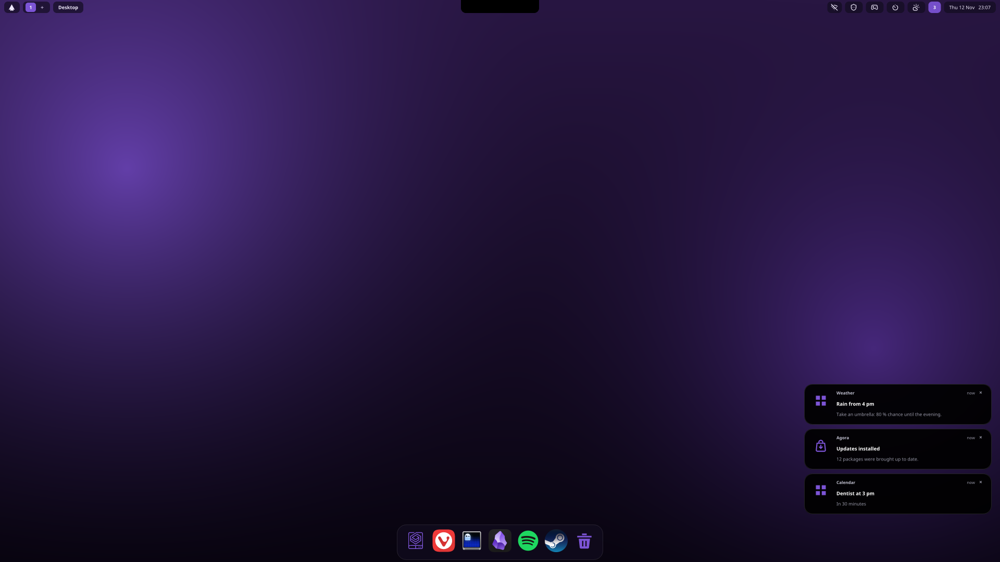

## What is in it

| Folder | Program | What it is |
| --- | --- | --- |
| `packages/session` | `yggdrasil-session` | the session on Hyprland: its configuration (Lua), window rules, keys, and a small Hyprland plugin so programs' own minimize buttons work |
| `packages/panel` | `yggdrasil-panel` | top bar, dock, tray, start menu, calendar, notifications, wallpaper, and Fylgja (the notch) ([docs/FYLGJA.md](docs/FYLGJA.md), [docs/NOTIFICATIONS.md](docs/NOTIFICATIONS.md)) |
| `packages/settings` | `yggdrasil-settings` | Settings: Wi-Fi & Network (each saved network has its own page: auto-join, private address, IPv4 and IPv6, DNS, proxy, forget; Wired only with a cable in; Devices, who is on a trusted home network, from the security integration's `devices_scan`; Wi-Fi checks, why the Wi-Fi is slow, from its `wifi_check`: [docs/INTEGRATIONS.md](docs/INTEGRATIONS.md)), displays, sound, appearance, power, cooling and idle, users and their rights, security, restore points, apps, games (graphics cards, game fixes, frame generation) and more |
| `packages/minos` | `minos` | the file manager, and (through `packages/portal`) the open and save dialog of every program ([keys](docs/keys/minos.md)) |
| `packages/market` | `agora` | Agora, the app store: the catalog, the Arch repositories, the AUR and Flathub in one place ([docs/MARKETPLACE.md](docs/MARKETPLACE.md)) |
| `packages/lock` | `yggdrasil-lock`, `yggdrasil-greeter`, `yggdrasil-shot` | the lock screen and the login screen with selectable designs ([docs/LOCKSCREEN.md](docs/LOCKSCREEN.md), [docs/LOGIN_SCREEN.md](docs/LOGIN_SCREEN.md)), the boot splash, and the screenshot tool (Print: freezes the screen first, so open menus can be captured) |
| `packages/installer` | `yggdrasil-installer` | the installer's window: language, keyboard (by type: QWERTY, QWERTZ, AZERTY, Dvorak, Colemak), time zone, disk (erase, or choose partitions beside Windows), account; the OS supplies the install steps ([docs/INSTALLER.md](docs/INSTALLER.md)) |
| `packages/player` | `yggdrasil-player` | video player: VLC (libVLC) in Yggdrasil's window |
| `packages/idle` | `yggdrasil-idle` | dims, blacks out the screen (pointer hidden), locks, turns the screen off and sleeps when you are away; keyboard lights off with the screen |
| `packages/polkit` | `yggdrasil-polkit` | the password box for administrator actions, Wi-Fi and VPN passwords, and Bluetooth pairing |
| `packages/portal` | `yggdrasil-portal` | the file chooser portal (Minos) |
| `packages/keyring-sync` | `yggdrasil-keyring-sync` | keeps the keyring and the login password in step ([docs/USERS_KEYRING.md](docs/USERS_KEYRING.md)) |
| `packages/xmove` | `yggdrasil-xmove` | lets X11 programs that draw their own title bar (Steam) be moved and resized |
| `packages/compositor` | `yggdrasil-compositor` | Yggdrasil's own compositor (Smithay), in progress |
| `packages/calculator`, `packages/weather` | | small apps ([docs/WEATHER.md](docs/WEATHER.md)) |
| `packages/saga-md` | `saga-md` | Saga MD, the Markdown reader: a Markdown or text file formatted, or its source to read and edit; Ctrl + E switches ([README](packages/saga-md/README.md)) |
| `packages/spell` | `yggdrasil-spell`, `yggdrasil-autocorrect` | spell checking in every app: the Hunspell dictionaries, one word list your apps share, a list shared by the computer, and correct as you type ([README](packages/spell/README.md)) |
| `packages/clipboard` | `yggdrasil-clipboard` | clipboard history and snippets (Win + V) |
| `packages/colorpicker` | `yggdrasil-colorpicker` | pick a colour anywhere on the screen and copy it (Win + Shift + C) |
| `packages/authenticator` | `yggdrasil-authenticator` | Proton Authenticator's codes: type to search, Enter copies |
| `packages/timer` | `yggdrasil-timer` | a countdown timer in the top bar |
| `packages/health` | `yggdrasil-health` | break reminders (eyes, movement, water, breathing, meals, wind-down) with a top bar pill |
| `packages/leakwatch` | `yggdrasil-leakwatch` | the leak watch: every 5 minutes (a timer; nothing stays running) each program's memory and the images it left with Hyprland; a warning when one keeps growing for hours |
| `packages/controllers` | `yggdrasil-controllers` | game controllers in the top bar: battery, rumble test, light bar colour, notifications |
| `packages/gamepads` | | the game controller library that Settings and the controllers add-on share (reads sysfs) |
| `packages/agent-usage` | `yggdrasil-agent-usage` | a top bar add-on: how much of Claude's weekly and 5-hour limits is used |
| `packages/browser-warm` | `yggdrasil-browser-warm` | keeps the default browser running with no windows, so new windows and links open almost at once |
| `packages/game-2048`, `packages/sudoku` | `yggdrasil-2048`, `yggdrasil-sudoku` | games: 2048 and Sudoku |
| `packages/yggdrasil-ui`, `packages/yggdrasil-conf` | | the shared look (egui theme, icons, window chrome) and the shared settings and integration files |
| `packages/liki` | `liki-build` and others | **Liki**, the icon pack ([docs/LIKI.md](docs/LIKI.md)) |
| `packages/theme` | `ygg-theme`, `ygg-cursors` | the look of GTK and Qt programs (dark mode included) and the mouse pointer ([docs/THEME.md](docs/THEME.md)) |
| `packages/pkgbuilds` | | an Arch package recipe for each program, built from this repository |

<!-- shortcuts:start -->
## Keyboard shortcuts

The desktop's own (Win is the Super key). Settings > Keyboard Shortcuts and Win + / show the live list, your own
additions included; [docs/SHORTCUTS.md](docs/SHORTCUTS.md) is the same list. This part is made from
`packages/session/hyprland/yggdrasil.lua` (`YGGDRASIL_WRITE_DOCS=1 cargo test` in `packages/yggdrasil-conf`).

### Windows

| Keys | What it does |
| --- | --- |
| Win + Shift + Z | Window zones for the window in front |
| Alt + F4 | Close the window (programs that keep running: hide it) |
| Win + Q | Close the window (programs that keep running: hide it) |
| Win + F | Full screen |
| Win + ↑ | Maximize (again: restore), or focus up on a tiling screen |
| Win + ↓ | Minimize, or focus down on a tiling screen |
| Win + W | Close the window (as in Omarchy) |
| Win + Shift + M | Show minimized windows |
| Win + ← | Left half, or focus left on a tiling screen |
| Win + → | Right half, or focus right on a tiling screen |
| Win + T | Tile or float the window |
| Alt + Tab | Next window |
| Alt + Shift + Tab | Previous window |

### Desktops

| Keys | What it does |
| --- | --- |
| Win + Ctrl + ← | Previous desktop |
| Win + Ctrl + → | Next desktop |
| Win + Ctrl + 1-4 | Desktop 1-4 |
| Win + Ctrl + Shift + 1-4 | Move the window to desktop 1-4 |

### Apps

| Keys | What it does |
| --- | --- |
| Win + S | Talk to the assistant (tap to start, tap to send) |
| Ctrl + Alt + S | Talk to the assistant (tap to start, tap to send) |
| Win + V | Clipboard history and snippets |
| Win + E | Files (Minos) |
| Win + Return | Terminal |
| Ctrl + Shift + Esc | Task Manager (again: brings it to the front) |
| Win + Shift + C | Color picker |
| Win + Alt + − | Magnifier: zoom out |
| Win + Alt + 0 | Magnifier off |
| Win + Alt + S | Screen reader (Orca) on or off |

### System

| Keys | What it does |
| --- | --- |
| Win | Start menu |
| Win + C | Calendar |
| Win + N | Notifications |
| Win + I | Settings |
| Win + L | Lock the screen |
| Win + / | Keyboard shortcuts |

### Mouse

| Keys | What it does |
| --- | --- |
| Win + Left drag | Move the window |
| Win + Right drag | Resize the window |
| Win + Alt + = | Magnifier: zoom in around the pointer |
| Ctrl twice | Find my mouse |

### Screenshots

| Keys | What it does |
| --- | --- |
| Print Screen | Screenshot (area, window or screen) |
| Win + Shift + S | Screenshot (area, window or screen) |

### Media keys

| Keys | What it does |
| --- | --- |
| Volume up | Volume up |
| Volume down | Volume down |
| Mute | Mute |
| Microphone mute | Microphone mute |
| Play | Play |
| Pause | Pause |
| Next track | Next track |
| Previous track | Previous track |
| Stop | Stop |
| Brightness up | Brightness up |
| Brightness down | Brightness down |
<!-- shortcuts:end -->

### In the apps

| App | Main keys | All of them |
| --- | --- | --- |
| Top bar, dock, start menu | Esc closes any popup; in the start menu type to search, Enter opens; Win + / any key closes the shortcuts card | [docs/keys/panel.md](docs/keys/panel.md) |
| Minos (files) | Ctrl + T / W new / close tab, Alt + ← / → back / forward, Ctrl + F search, Ctrl + L address, F2 rename, Delete to the bin, F3 preview | [docs/keys/minos.md](docs/keys/minos.md) |
| Clipboard (Win + V) | ↑ ↓ move, Enter copies, Shift + Enter pastes, Tab history / snippets, Ctrl + P pin, Ctrl + N new snippet | [docs/keys/clipboard.md](docs/keys/clipboard.md) |
| Color Picker (Win + Shift + C) | arrows move one pixel, wheel zooms, Enter or click picks, Esc cancels | [docs/keys/colorpicker.md](docs/keys/colorpicker.md) |
| Screenshot, lock and login screens | screenshot: drag an area, click a window, Enter whole screen; lock: Enter unlocks, Esc clears; login: Tab another user, F2 session | [docs/keys/lock-and-login.md](docs/keys/lock-and-login.md) |
| Authenticator | type to search, ↑ ↓ move, Enter copies the code | [docs/keys/authenticator.md](docs/keys/authenticator.md) |
| Calculator | type the sum, Enter works it out, Esc clears | [docs/keys/calculator.md](docs/keys/calculator.md) |
| Saga MD (Markdown) | Ctrl + E formatted / source, Ctrl + S save, Ctrl + O open, Alt + ← back, Ctrl + + / − / 0 text size | [docs/keys/saga-md.md](docs/keys/saga-md.md) |
| Video player | Space or K play / pause, ← → or J / L step, ↑ ↓ volume, M mute, F full screen, O open | [docs/keys/player.md](docs/keys/player.md) |
| 2048 | arrows, WASD or HJKL slide, U undo, N new game | [docs/keys/2048.md](docs/keys/2048.md) |
| Sudoku | arrows or HJKL move, 1-9 place, N notes, U undo, Shift + H hint, P pause | [docs/keys/sudoku.md](docs/keys/sudoku.md) |
| Settings, Agora, installer | no shortcuts of their own (Tab, Enter and typing as usual) | [docs/keys/settings-agora-installer.md](docs/keys/settings-agora-installer.md) |

## Screenshots

Applications are shown as windows on a 1920×1080 desktop.

| | |
| --- | --- |
| 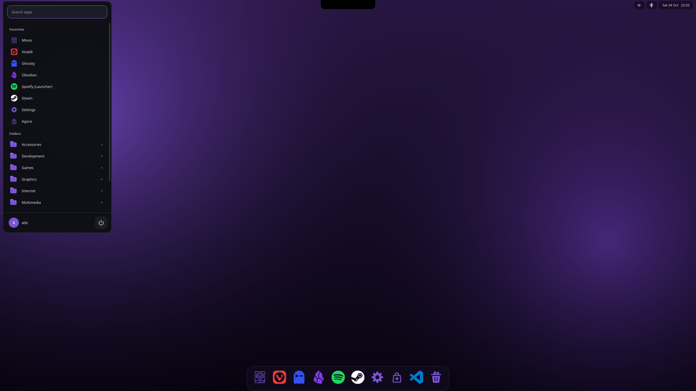 | 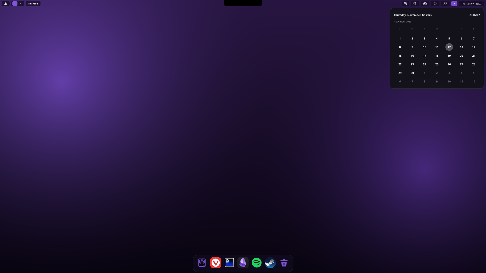 |
| *The start menu: favourites, folders by category, search.* | *The calendar, from the date in the top bar.* |
| 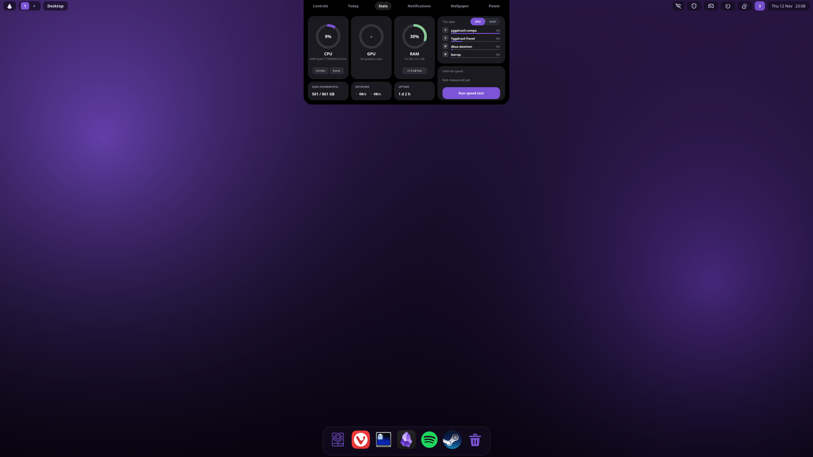 | 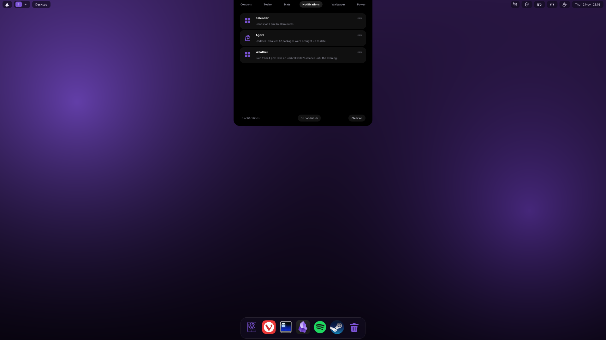 |
| *Fylgja, the notch: Stats (processor, graphics card, memory, disk, network, the busiest apps).* | *Fylgja: the notification history, grouped by app.* |
| 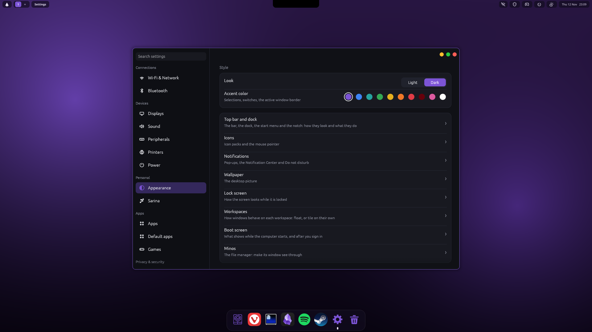 | 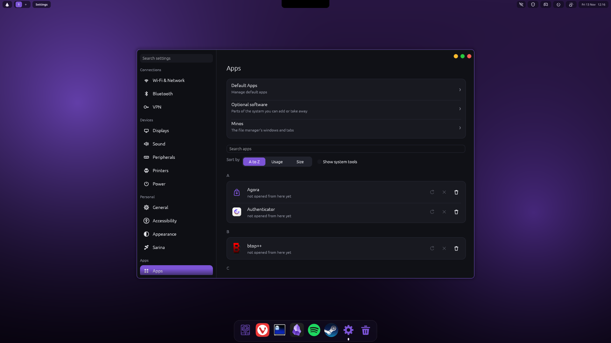 |
| *Settings: Appearance.* | *Settings: Apps, sorted by use, with restart, quit and remove.* |
| 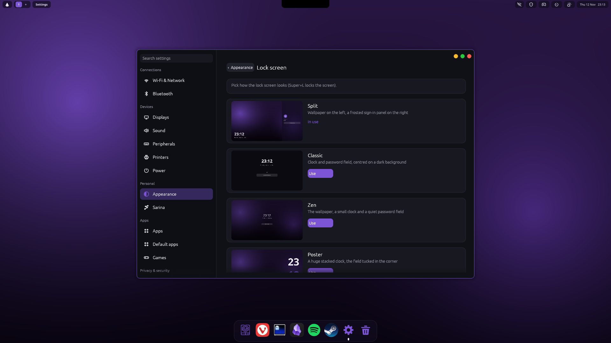 | 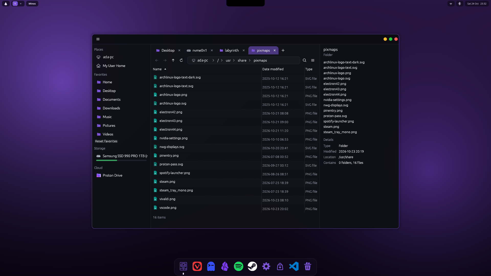 |
| *Settings: the lock screen designs.* | *Minos, the file manager: tabs, places, details.* |
| 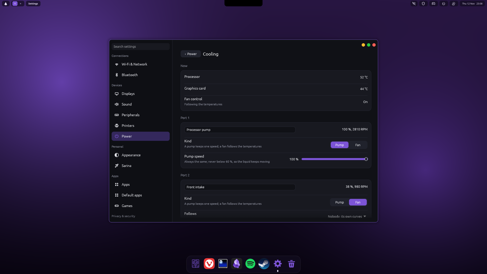 | 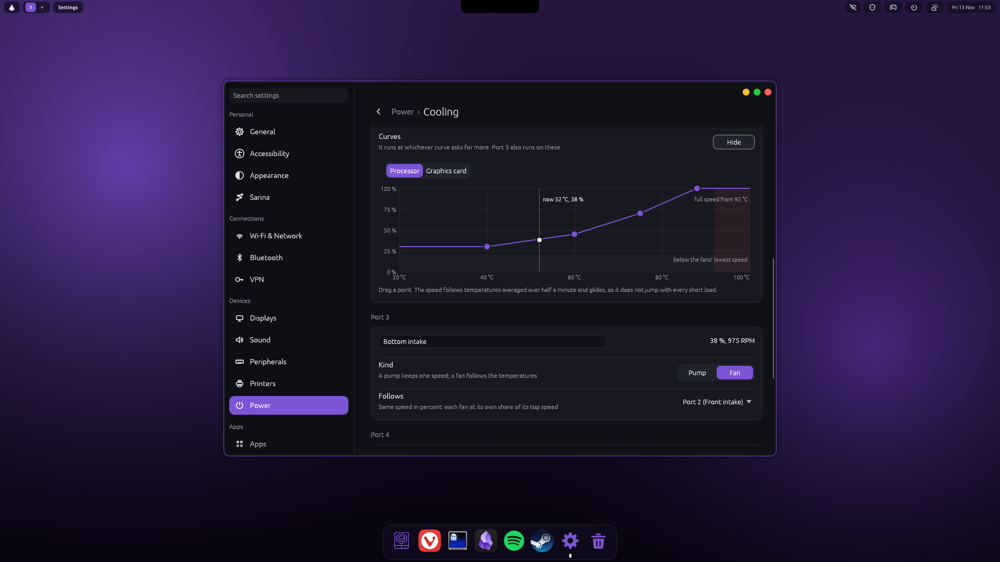 |
| *Settings: Power > Cooling. The temperatures, and each port with your own name for it, pump or fan, and its speed now.* | *Settings: a fan's own curves, one for the processor and one for the graphics card, dragged point by point. Another fan can follow them.* |
| 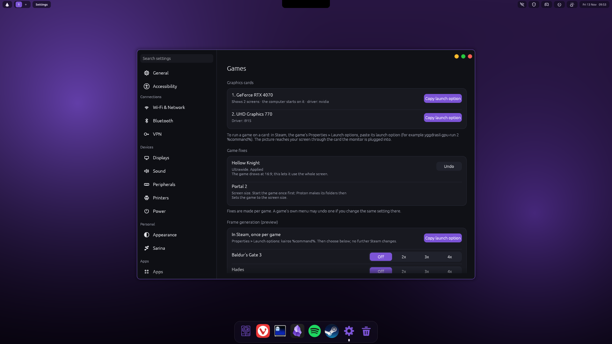 | |
| *Settings: Games. The graphics cards (with two or more, a Steam launch option runs a game on the one you pick), game fixes (Dead Space 2 and Fallout 4 at your screen's size, with Undo), and frame generation per game: Labyrinth's own (a preview) and Lossless Scaling's.* | |
| 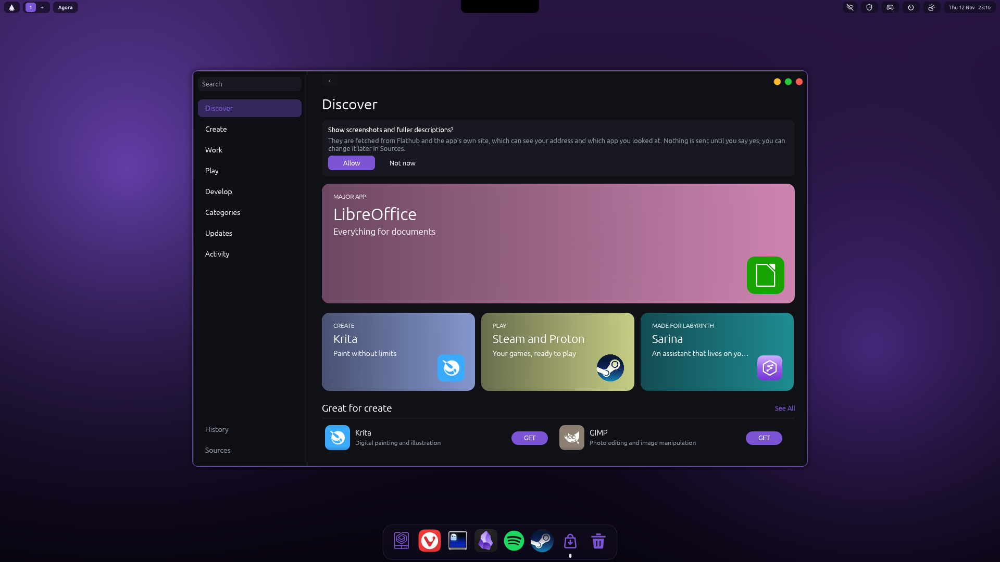 | 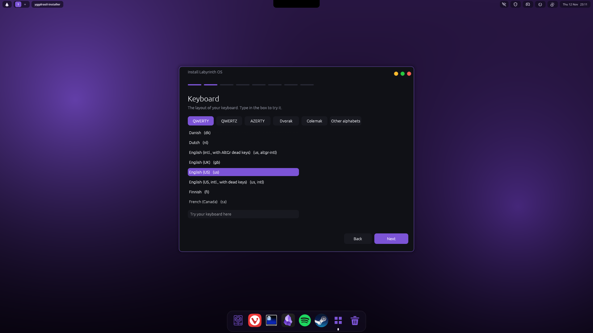 |
| *Agora, the app store.* | *The installer: keyboards by type.* |
| 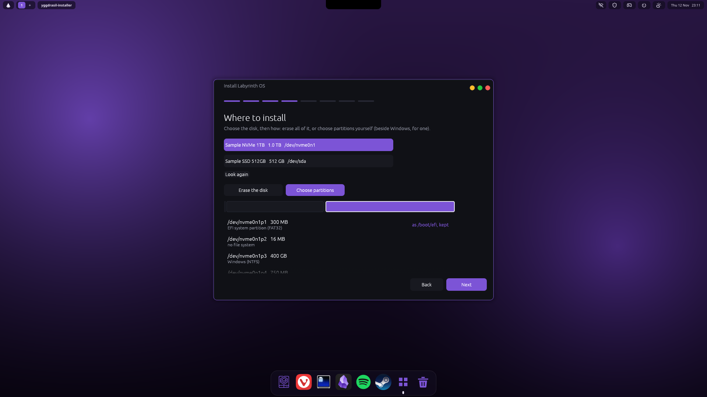 | 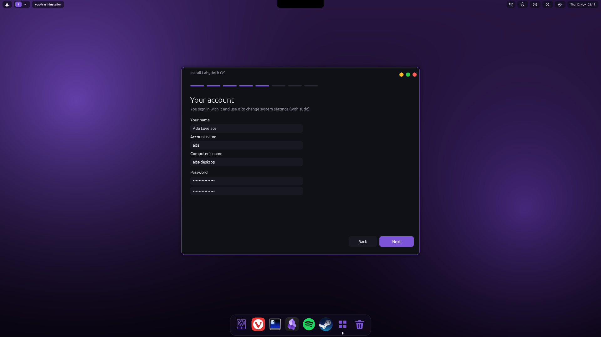 |
| *The installer: choosing partitions beside Windows (sample disks).* | *The installer: the account (sample name).* |

The installer pictures use `yggdrasil-installer --demo PAGE`: sample disks and names, and nothing can be installed from it.
The others come from `scripts/screenshot-desktop.sh`, which shows the desktop on a 1920×1080 screen inside a running Hyprland
session (`start`, `run yggdrasil-settings power:cooling`, `shot FILE.png`, `stop`) and changes nothing in that session.

## Building

Every program is its own Cargo project (`cd packages/<name> && cargo build --release`); they all build into one shared folder,
`target/` at the top of the repository (`.cargo/config.toml`), so the libraries they share are compiled once. A program built
by hand is in `target/release/`. `packages/pkgbuilds/<name>/PKGBUILD` builds a package from the source next to it
(`makepkg -f` in that folder). Labyrinth OS builds them with its `scripts/build-local-packages.sh`, for any 64-bit CPU
(its `scripts/makepkg.conf`); a plain `makepkg` uses this machine's settings, which on CachyOS build for this CPU only. Tests: `cargo test` in each folder; CI runs them and `cargo audit`.

Some pages appear only when the operating system provides what they need (for example Settings > Security > Distress password needs
Labyrinth's `labyrinth-distress`, and the security monitor's pages need a `security` integration such as Heimdall's).

Licence: Mozilla Public License 2.0 ([LICENSE](LICENSE)). See [THIRD_PARTY_NOTICES.md](THIRD_PARTY_NOTICES.md) for what is built on, under its own licences.
