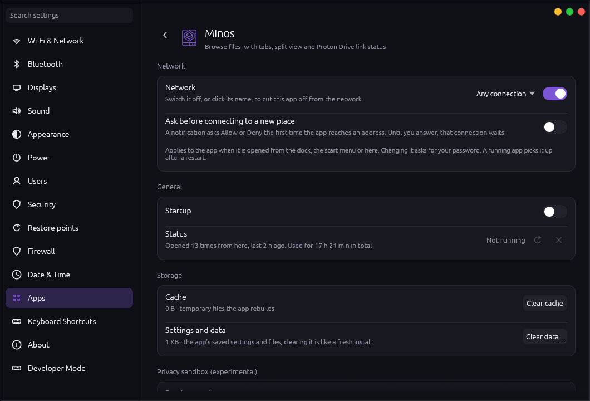
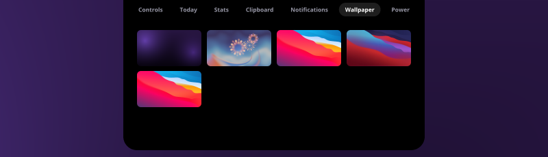

# Yggdrasil

**Yggdrasil** is a desktop environment written in Rust, built to replace KDE piece by piece. It is the desktop of [Labyrinth OS](https://github.com/Artifex-Technologies/Labyrinth_OS)
and is meant to be reused by other systems (Chymaera OS will use it too), so nothing here may depend on anything that only Labyrinth has.

Status: it runs on top of KWin today (KWin is the only KDE piece left that matters); the compositor that replaces it is a first version that runs in a window
([docs/COMPOSITOR.md](docs/COMPOSITOR.md)). Plans and decisions: [docs/YGGDRASIL.md](docs/YGGDRASIL.md), [docs/DESKTOP_ROADMAP.md](docs/DESKTOP_ROADMAP.md),
[docs/KDE_INVENTORY.md](docs/KDE_INVENTORY.md) (what KDE still does and what replaces it).

## What is in it

| Folder | Program | What it is |
| --- | --- | --- |
| `packages/panel` | `yggdrasil-panel` | top bar, dock, tray, start menu, calendar, notifications, wallpaper, and Fylgja (the notch) ([docs/FYLGJA.md](docs/FYLGJA.md), [docs/NOTIFICATIONS.md](docs/NOTIFICATIONS.md)) |
| `packages/settings` | `yggdrasil-settings` | Settings: network, displays, sound, appearance, power and idle timers, users, security, apps and more |
| `packages/minos` | `minos` | the file manager, and (through `packages/portal`) the open and save dialog of every program ([docs/MINOS_KEYS.md](docs/MINOS_KEYS.md)) |
| `packages/market` | `agora` | the Marketplace: the catalog, the Arch repositories, the AUR and Flathub in one place ([docs/MARKETPLACE.md](docs/MARKETPLACE.md)) |
| `packages/lock` | `yggdrasil-lock`, `yggdrasil-greeter` | the lock screen and the login screen, with selectable designs ([docs/LOCKSCREEN.md](docs/LOCKSCREEN.md), [docs/LOGIN_SCREEN.md](docs/LOGIN_SCREEN.md)) |
| `packages/idle` | `yggdrasil-idle` | dims, locks, turns the screen off and sleeps when you are away |
| `packages/polkit` | `yggdrasil-polkit` | the password box for administrator actions |
| `packages/portal` | `yggdrasil-portal` | the file chooser portal (Minos) |
| `packages/keyring-sync` | `yggdrasil-keyring-sync` | keeps the keyring and the login password in step ([docs/USERS_KEYRING.md](docs/USERS_KEYRING.md)) |
| `packages/compositor` | `yggdrasil-compositor` | the compositor (Smithay): the future replacement for KWin |
| `packages/calculator`, `packages/yggdrasil-weather` | | small apps ([docs/WEATHER.md](docs/WEATHER.md)) |
| `packages/labyrinth-ui`, `packages/labyrinth-conf` | | the shared look (egui theme, icons, window chrome) and the shared settings file |
| `packages/liki` | `liki-build` and others | **Liki**, the icon pack ([docs/LIKI.md](docs/LIKI.md)) |
| `packages/theme` | `ygg-theme`, `ygg-cursors` | the look of Qt, KDE and GTK programs and the mouse pointer ([docs/THEME.md](docs/THEME.md)) |
| `packages/pkgbuilds` | | an Arch package recipe for each program, built from this repository |

The programs keep their `labyrinth-*` names until the rename to `yggdrasil-*` (it waits until the compositor can replace KWin: [docs/YGGDRASIL.md](docs/YGGDRASIL.md)).

## Screenshots

| | |
| --- | --- |
|  |  |
|  |  |
|  |  |
|  |  |

Fylgja, the notch:   

## Building

Every program is its own Cargo project (`cd packages/<name> && cargo build --release`). `packages/pkgbuilds/<name>/PKGBUILD` builds a package from the source next to it
(`makepkg -f` in that folder). Labyrinth OS builds them with its `scripts/build-local-packages.sh`. Tests: `cargo test` in each folder; CI runs them and `cargo audit`.

Some pages are for Labyrinth only and appear only when their program is installed (for example Settings > Security > Distress password needs `labyrinth-distress`).

Licence: see [THIRD_PARTY_NOTICES.md](THIRD_PARTY_NOTICES.md) for what is built on.
