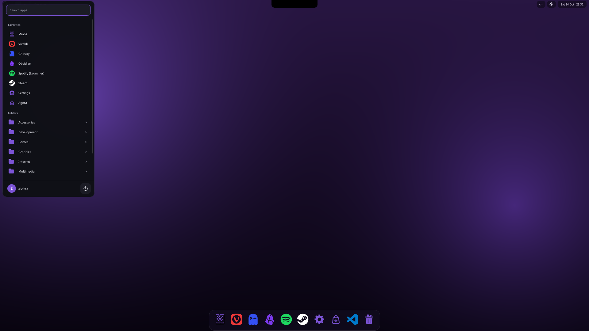
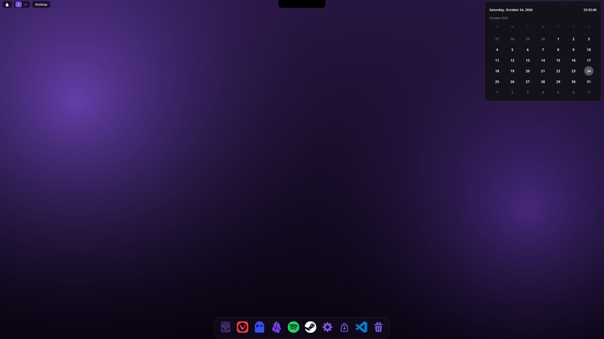
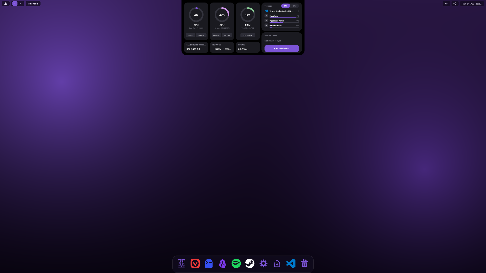
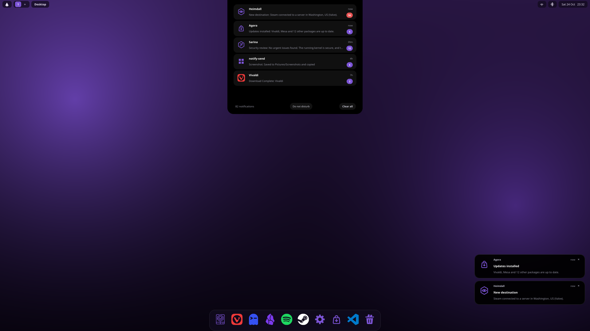
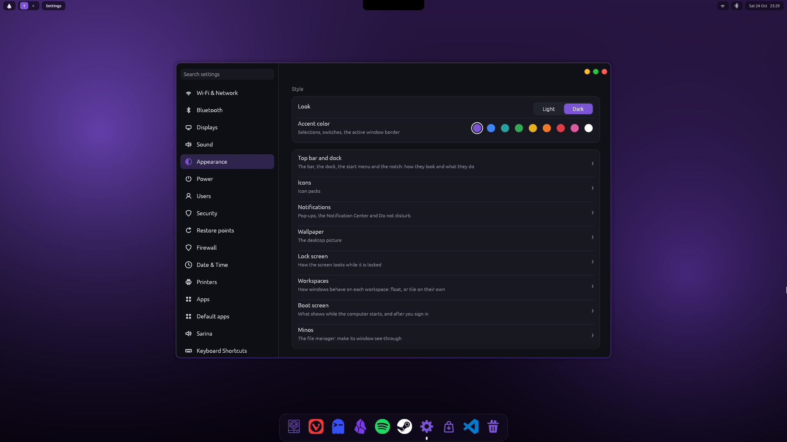
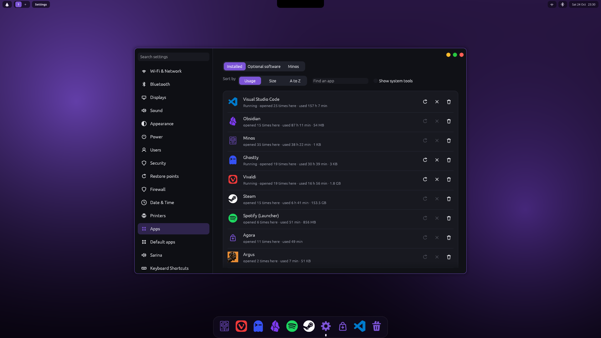
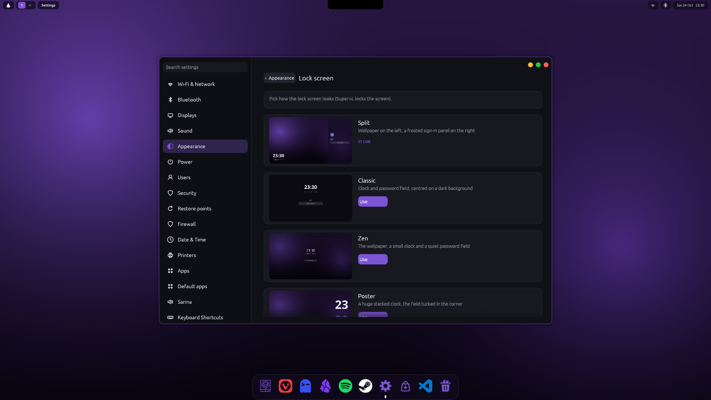
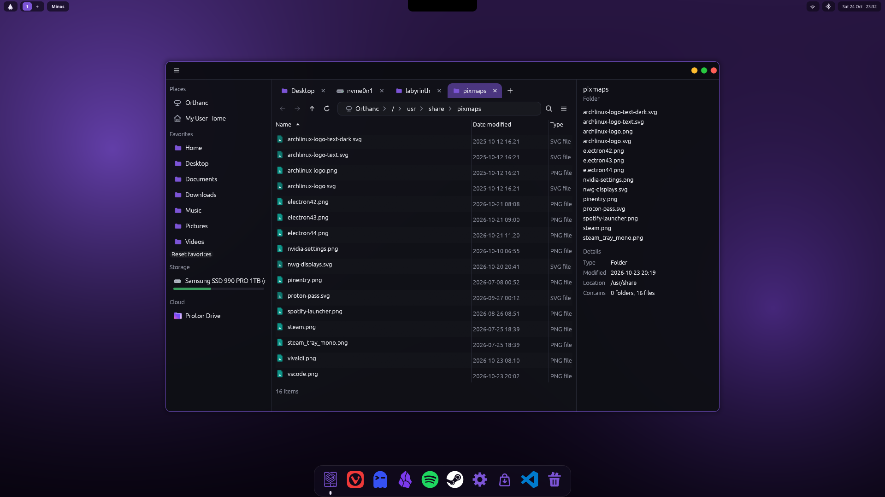
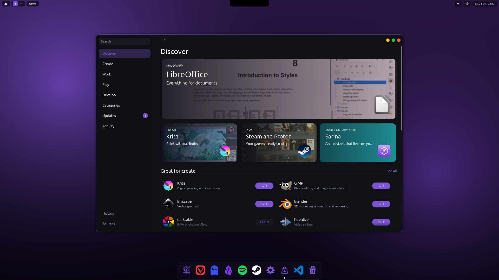
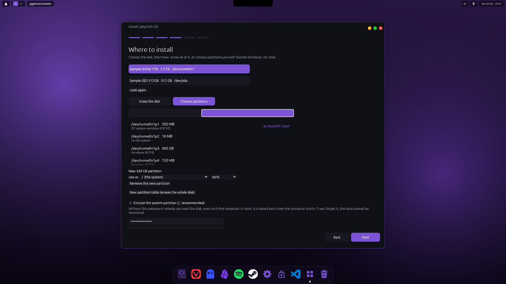

# Yggdrasil

**Yggdrasil** is a desktop environment written in Rust. It is the desktop of [Labyrinth OS](https://github.com/Artifex-Technologies/Labyrinth_OS)
and is built to be reused by other systems (Niflheim OS, formerly Chymaera OS, will use it too), so nothing here may depend on one
operating system: what an OS adds (an assistant, a security monitor, an installer's steps) it describes in integration files
([docs/INTEGRATIONS.md](docs/INTEGRATIONS.md)), and Yggdrasil shows the matching features.

Status: Yggdrasil runs as its own session on [Hyprland](https://hyprland.org) (`yggdrasil-session`), with Yggdrasil's own top bar,
dock, Settings, file manager, app store, lock and login screens, password box and installer. KDE is gone from the session; two
KDE libraries are still linked by the panel (`libkscreen`, `kconfig`) and are next to go. Yggdrasil's own compositor is a first
version that runs in a window ([docs/COMPOSITOR.md](docs/COMPOSITOR.md)). The checklist for a desktop of its own:
[docs/INDEPENDENCE.md](docs/INDEPENDENCE.md).

## What is in it

| Folder | Program | What it is |
| --- | --- | --- |
| `packages/session` | `yggdrasil-session` | the session on Hyprland: its configuration (Lua), window rules, keys, and a small Hyprland plugin so programs' own minimize buttons work |
| `packages/panel` | `yggdrasil-panel` | top bar, dock, tray, start menu, calendar, notifications, wallpaper, and Fylgja (the notch) ([docs/FYLGJA.md](docs/FYLGJA.md), [docs/NOTIFICATIONS.md](docs/NOTIFICATIONS.md)) |
| `packages/settings` | `yggdrasil-settings` | Settings: network, displays, sound, appearance, power and idle, users and their rights, security, restore points, apps and more |
| `packages/minos` | `minos` | the file manager, and (through `packages/portal`) the open and save dialog of every program ([docs/MINOS_KEYS.md](docs/MINOS_KEYS.md)) |
| `packages/market` | `agora` | Agora, the app store: the catalog, the Arch repositories, the AUR and Flathub in one place ([docs/MARKETPLACE.md](docs/MARKETPLACE.md)) |
| `packages/lock` | `yggdrasil-lock`, `yggdrasil-greeter`, `yggdrasil-shot` | the lock screen and the login screen with selectable designs ([docs/LOCKSCREEN.md](docs/LOCKSCREEN.md), [docs/LOGIN_SCREEN.md](docs/LOGIN_SCREEN.md)), the boot splash, and the screenshot tool (Print: freezes the screen first, so open menus can be captured) |
| `packages/installer` | `yggdrasil-installer` | the installer's window: language, keyboard (by type: QWERTY, QWERTZ, AZERTY, Dvorak, Colemak), time zone, disk (erase, or choose partitions beside Windows), account; the OS supplies the install steps ([docs/INSTALLER.md](docs/INSTALLER.md)) |
| `packages/player` | `yggdrasil-player` | video player: VLC (libVLC) in Yggdrasil's window |
| `packages/idle` | `yggdrasil-idle` | dims, locks, turns the screen off and sleeps when you are away; keyboard lights off with the screen |
| `packages/polkit` | `yggdrasil-polkit` | the password box for administrator actions, Wi-Fi and VPN passwords, and Bluetooth pairing |
| `packages/portal` | `yggdrasil-portal` | the file chooser portal (Minos) |
| `packages/keyring-sync` | `yggdrasil-keyring-sync` | keeps the keyring and the login password in step ([docs/USERS_KEYRING.md](docs/USERS_KEYRING.md)) |
| `packages/xmove` | `yggdrasil-xmove` | lets X11 programs that draw their own title bar (Steam) be moved and resized |
| `packages/compositor` | `yggdrasil-compositor` | Yggdrasil's own compositor (Smithay), in progress |
| `packages/calculator`, `packages/weather` | | small apps ([docs/WEATHER.md](docs/WEATHER.md)) |
| `packages/yggdrasil-ui`, `packages/yggdrasil-conf` | | the shared look (egui theme, icons, window chrome) and the shared settings and integration files |
| `packages/liki` | `liki-build` and others | **Liki**, the icon pack ([docs/LIKI.md](docs/LIKI.md)) |
| `packages/theme` | `ygg-theme`, `ygg-cursors` | the look of GTK and Qt programs (dark mode included) and the mouse pointer ([docs/THEME.md](docs/THEME.md)) |
| `packages/pkgbuilds` | | an Arch package recipe for each program, built from this repository |

## Screenshots

Applications are shown as windows on a 1920×1080 desktop.

| | |
| --- | --- |
|  |  |
| *The start menu: favourites, folders by category, search.* | *The calendar, from the date in the top bar.* |
|  |  |
| *Fylgja, the notch: Stats (processor, graphics card, memory, disk, network, the busiest apps).* | *Fylgja: the notification history, grouped by app.* |
|  |  |
| *Settings: Appearance.* | *Settings: Apps, sorted by use, with restart, quit and remove.* |
|  |  |
| *Settings: the lock screen designs.* | *Minos, the file manager: tabs, places, details.* |
|  |  |
| *Agora, the app store.* | *The installer: keyboards by type.* |
|  |  |
| *The installer: choosing partitions beside Windows (sample disks).* | *The installer: the account (sample name).* |

The installer pictures use `yggdrasil-installer --demo PAGE`: sample disks and names, and nothing can be installed from it.

## Building

Every program is its own Cargo project (`cd packages/<name> && cargo build --release`). `packages/pkgbuilds/<name>/PKGBUILD` builds a package from the source next to it
(`makepkg -f` in that folder). Labyrinth OS builds them with its `scripts/build-local-packages.sh`. Tests: `cargo test` in each folder; CI runs them and `cargo audit`.

Some pages appear only when the operating system provides what they need (for example Settings > Security > Distress password needs
Labyrinth's `labyrinth-distress`, and the security monitor's pages need a `security` integration such as Heimdall's).

Licence: Mozilla Public License 2.0 ([LICENSE](LICENSE)). See [THIRD_PARTY_NOTICES.md](THIRD_PARTY_NOTICES.md) for what is built on, under its own licences.
