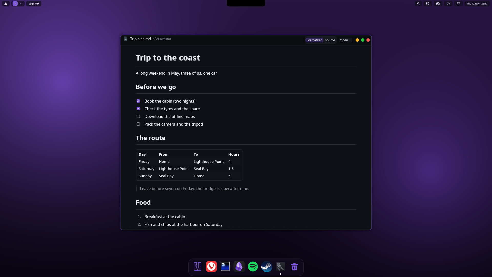

# Saga MD (`saga-md`)

Yggdrasil's Markdown reader; its icon is Saga's raven with a scroll in its claws (`saga-md.svg`, made by `icon/gen-icon.py` from a raven I had Gemini draw:
the branch it stood on became a scroll tied with a purple ribbon). One Markdown or text file in one page, in Yggdrasil's look (light or dark like the rest of the desktop):

- **Formatted** (Markdown files open this way): headings, bold and italic in the system font, lists and task lists, tables, quotes and
  GitHub's alerts (`> [!NOTE]`), code blocks with a Copy button, footnotes, pictures from the file's own folder.
- **Source** (other text files open this way): the text itself, which you can also edit; Ctrl+S saves.

The switch in the title bar, or **Ctrl+E**, changes between the two. There is never a second pane: I wanted one view at a time.

| Keys | |
| --- | --- |
| Ctrl+E | Formatted or source |
| Ctrl+S | Save (source changes) |
| Ctrl+O | Open another file (the desktop's file chooser), or drop one on the window |
| Alt+Left | Back to the page before (after following a link to another Markdown file) |
| Ctrl+plus, Ctrl+minus, Ctrl+0, Ctrl+wheel | Text size, back to 100 % |
| F5 | Read the file again |

- Links to web pages open in the browser; links to other Markdown and text files open here; `#anchors` scroll to their heading;
  links to anything else open in its own program.
- Nothing is fetched from the web: a picture on the web shows as a link. HTML in a file is never run (its text, headings and
  `` pictures show; scripts and styles are skipped).
- When another program writes the file, the page follows by itself (a file checked once a second, by a thread of its own, so an
  idle window does no work). If you have unsaved changes it asks instead; unsaved changes are never thrown away without asking,
  also when closing the window.
- Saving writes a new copy beside the file and puts it in place, so a crash never leaves half a file. Files you cannot write, and
  files that are not UTF-8 text, open read-only.

Not done yet: find on the page, syntax colours in code blocks, line numbers in the source.

    saga-md [--source] [--zoom PERCENT] [FILE[#heading]]
