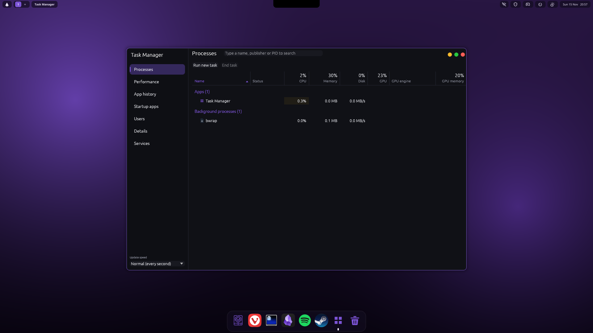
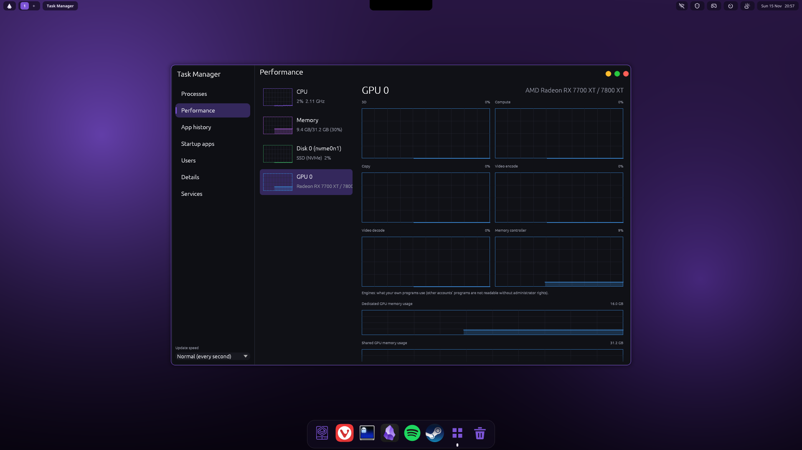

# Task Manager

Yggdrasil's task manager (`yggdrasil-taskmanager`), laid out like the one on Windows 11, in the desktop's look (light or dark,
the accent colour from Settings). Ctrl+Shift+Esc opens it; pressing it again brings the open one to the front.

| | |
| --- | --- |
|  |  |
| *Processes, with the GPU, GPU engine and GPU memory columns.* | *Performance: a graphics card's engines and memory (a made-up AMD card; `scripts/screenshots.sh`).* |

| Tab | What it shows and does |
|:--|:--|
| Processes | Apps (a window's process with all its helpers), background processes and the system's, with CPU, memory, disk and graphics (GPU, GPU engine, GPU memory) shaded by how busy they are. End task, force it to end, suspend and resume, bring to front, close its windows, properties, search online |
| Performance | Live graphs over a minute: CPU (overall or each logical processor), memory, each disk, each network adapter, each graphics card (its engines, memory, sensors and link; the AI models Ollama has loaded) |
| App history | Processor time and disk read and written for each app since it started |
| Startup apps | Autostart entries and the background services switched on in your account: enable or disable them |
| Users | Who is signed in, with their processor and memory use and apps |
| Details | Every process: PID, status, account, CPU, memory, threads, priority (set it), GPU, GPU engine, GPU memory and shared GPU memory, command line |
| Services | The system's services and yours: start, stop, restart, start automatically or not |

Run new task starts a program, opens a folder or a web address, with administrator rights when asked (pkexec).

How it reads: a background thread looks at /proc once a second (twice, every 4 seconds or paused, at the bottom of the sidebar),
so the window stays smooth; about 3 % of one processor core while it is open, nothing when closed. The graphics cards are asked
only while Processes, Details or Performance shows (see below), services and sign-ins only while their tab does. Memory is a process's own (resident minus shared), so an app's helper processes add up without counting shared
libraries twice. Another account's processes are ended through polkit (it asks for your password), and ending one that
belongs to the system or the desktop session asks first.

Ideas from [task-manager-for-mac](https://github.com/yatindma/task-manager-for-mac) (MIT, Swift): the seven tabs and the
heat shading; no code from it (different language and system).

## Graphics cards

Each card gets its own entry on the Performance tab (GPU 0, GPU 1, ... numbered by where it sits, so a laptop's integrated chip
at 00:02.0 comes before its NVIDIA card), laid out like Windows 11: a graph per engine (3D, compute, copy, video encode, video
decode, and the memory controller where the driver says how busy it is), dedicated and shared memory over the minute, then
utilisation, memory, temperature, power and its limit, core and memory clock (with the top clock), fan, PCIe link (and on
NVIDIA its traffic), driver and location. Below them, when Ollama runs, the models it has loaded and how much of each sits in
the card's memory (asked from Ollama's own API on 127.0.0.1:11434 every 5 seconds while that page is open; nothing when it does
not answer). Per process (Processes and Details): GPU is its busiest engine's share, GPU engine names that engine ("GPU 0 -
3D"), GPU memory what it holds on the card, Shared GPU what the card holds for it in system memory; Properties adds the graphics
libraries it has loaded (CUDA, Vulkan, OpenGL, OpenCL, ggml, ONNX Runtime, PyTorch, NVENC, VA-API, read from /proc/PID/maps at
most every 30 seconds). A process that holds no card has empty cells, not 0 %.

| Card | Where the numbers come from |
|:--|:--|
| NVIDIA | NVML (libnvidia-ml.so.1), opened with dlopen the first time a tab needs it and kept; queries only, through a binding of its own (`src/nvml.rs`) that has no set function at all. Per process: the running-process lists (card memory) and the utilisation samples (3D/compute, encoder, decoder share). The open kernel driver lists every program that holds the card as a compute process (the compositor, browsers, editors), so the lists are read as "holds the card" and the engine comes from the samples. Temperature, power, clocks, fan and link are read every 2 seconds (each costs the driver 1-3 ms), the top clocks once, PCIe traffic only while the card's page is open (the driver measures 20 ms for it). Its DRM node writes no usage stats (checked on driver 620), so no fdinfo is read for it. |
| AMD (amdgpu) | The driver's files: gpu_busy_percent, mem_busy_percent, VRAM and GTT used and total, the top clocks from pp_dpm_sclk/mclk; hwmon for temperature, power and cap, clocks, fan. Engines and per-process numbers from DRM fdinfo (below). |
| Intel (i915, xe) | Frequencies from the card's files (gt_act_freq_mhz, or tile0/gt0/freq0 on xe), local memory on a card that has its own, hwmon on a card (energy, so power is the difference of two readings), the processor's graphics power domain (RAPL "uncore") on an integrated chip when the system lets everyone read it (it usually does not). Engines and memory from DRM fdinfo. |
| Others (panfrost, panthor, v3d on a Raspberry Pi, ...) | DRM fdinfo only. |
| None, or a virtual machine's adapter | Not listed: a card is shown only when something about it can be read. |

DRM fdinfo (the kernel's Documentation/gpu/drm-usage-stats.rst): each open /dev/dri file of a process tells its busy time per
engine (or busy and total cycles), engines counted together (capacity) and memory per region (resident where given). The share
is the busy time between two looks over the time between them; the same client under two descriptors (drm-client-id) counts
once. Which processes hold such a file is found once per process and looked for again only when its number of open files
changes (the size of /proc/PID/fd), so a look reads fdinfo only for the few processes on a card. Linux shows another account's
files only to root, so on these cards the engines and per-process numbers are your own programs', and the page says so.

Measured on my PC (RTX 2080 Ti, open driver 620; headless in cage with software drawing, release build, two runs of 30 s per
tab, the share of one core including the drawing), before and after (2026-11-15): Processes 5.9-6.0 % and 6.3 %, Details
7.2-7.3 % and 7.4-7.5 %, Performance 7.0 % and 6.6-6.7 % (before, counting the nvidia-smi it started every 2 seconds; now the
card is read every second), a card's own page 6.6 %. The graphics look itself costs about 3 ms of CPU on Processes and Details,
and on Performance about 2.5 ms plus 7 ms every 2 seconds for the slow numbers. libnvidia-ml adds about 26 MB to the program
once loaded (the driver's own cost, as for Settings' power helpers).

Tested on: NVIDIA here. AMD and Intel only with the kernel documentation's examples and files laid out like their drivers'
(`cargo test`: drm.rs and gpu.rs); not yet on such hardware.

Ideas for the graphics part from [gputaskman](https://github.com/shanselman/gputaskman) (MIT, Python): per-process engines and
memory, runtimes from mapped libraries, Ollama's loaded models; no code from it.
